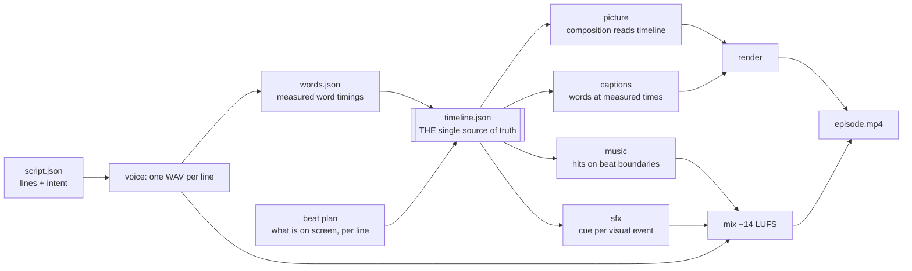
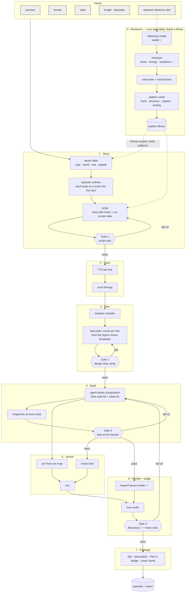
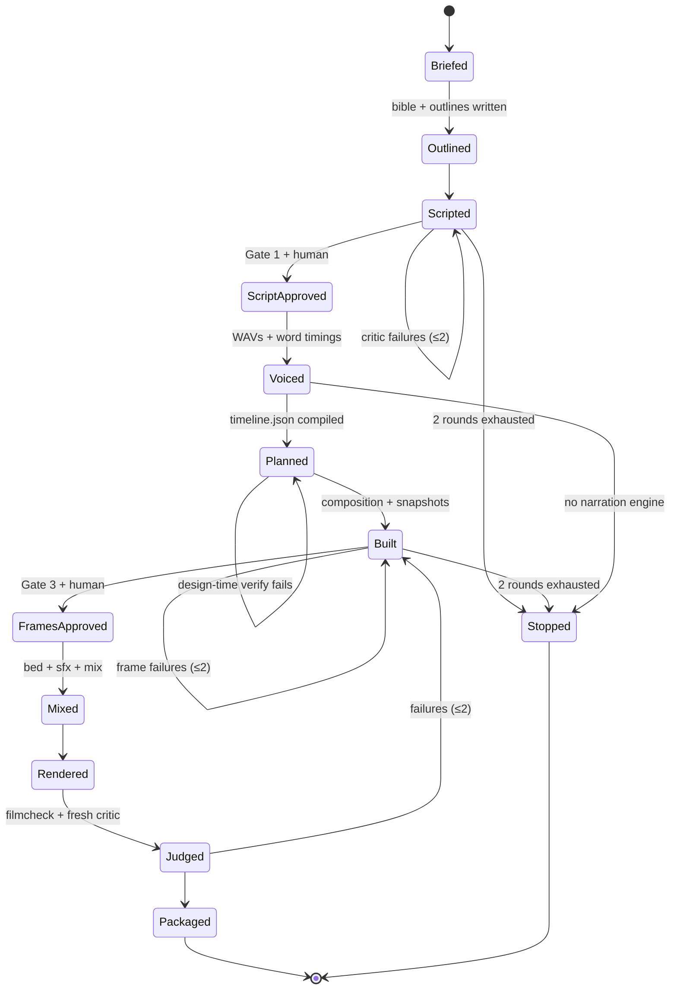

# 02 — The whole system: prompt + format + style → finished episode

**Written 2026-11-13.** This is a design derived from the research in
[01-landscape.md](01-landscape.md) and [flashloop/FINDINGS.md](flashloop/FINDINGS.md). **Nothing
here is built** unless it is marked ✅ *exists*. It is a proposal, not a decision — the decisions
it would need are listed in [06-gap-analysis-and-build-plan.md](06-gap-analysis-and-build-plan.md).

---

## 1. The product in one sentence

> The user gives **a premise, a format, a style, a length and an episode count**. The system
> returns that many finished vertical episodes — narrated, captioned, scored, mixed — and a
> report saying what was checked and what was not.

Those five inputs are exactly flashloop's. Everything else is the system's job.

## 2. The governing idea: one timeline, written once

Every weak agent-made video has the same root cause: picture, voice, captions and sound are made
by different steps that each guess at the timing. The fix — already stated in lemo-opuscar's
`TECHNIQUE.md`, which we noted and never implemented — is that **one timeline file drives
everything**. Narration is rendered *first*; its measured word timings become the clock; picture,
captions, music hits and sound effects are all placed against that clock and never against a
guess.



This also retires tech-debt items **D4, D6 and D7** (beats duplicated between `index.html` and
`*.beats.json`, drifting silently): the composition stops containing timing at all.

## 3. The full pipeline



✅ marks what exists today. Everything unmarked is unbuilt.

## 4. The artefact contract

Each stage reads files and writes files. Nothing is passed in an agent's head. This is what makes
a run resumable after a usage limit — which has already killed one session mid-work in this
project — and what lets a *different* agent judge the work.

```
series/<slug>/
  brief.json            the five inputs, verbatim, plus resolved format + style ids
  bible.json            cast, world, the rule, palette, voice ids, running gags, episode ledger
  ep01/
    outline.md          one paragraph + the closing dilemma
    script.json         [{id, text, intent, on_screen, emphasis_word}]
    script.review.md    Gate 1 verdict, by a critic that did not write it
    vo/L01.wav …        one file per line
    words.json          [{line, word, start, end}]  — measured, never estimated
    timeline.json       beats, scene ids, caption words, music hits, sfx cues — all in seconds
    composition/        index.html + scenes; reads timeline.json at render time
    snapshots/          one PNG per beat
    audio/              bed.wav, sfx.wav, mix.wav
    renders/ep01_<timestamp>.mp4
    report.md           what was measured, what passed, what was NOT checked
```

`bible.json` is the state layer the survey in [01-landscape.md](01-landscape.md) says skill-based
systems lack. It is why episode 4 can look and sound like episode 1.

## 5. Roles — who is allowed to do what

CLAUDE.md rule 7 says the builder does not grade its own work. Applied here:

| Role | Writes | Never does |
|---|---|---|
| **Researcher** | pattern cards, format recipes | write scripts |
| **Showrunner** | bible, outlines | write code |
| **Writer** | script | judge the script |
| **Script critic** | `script.review.md` | edit the script — returns numbered failures |
| **Builder** | composition, sound | declare the film done |
| **Film critic** | `report.md`, from the MP4 and snapshots only | read the builder's notes |
| **Human** | approves at Gate 1 (script) and Gate 3 (frames) | — |

The two human gates are deliberately the two *cheap* moments: before any rendering, and before
the final render. A 60-second episode is a 20–30 minute agent job on the published figures in
[01-landscape.md](01-landscape.md); nobody should discover a bad premise at minute 25.

## 6. Logical cases

### 6.1 Input resolution

| Case | Condition | Behaviour |
|---|---|---|
| A | Premise + format + style all given | Proceed |
| B | No format given | Classify the premise against the format library; propose the best two with a one-line reason; **ask** |
| C | No style given | Show the gallery previews; **ask** — a style is chosen by eye, never assigned |
| D | Reference reel given | Run it through reelkit; derive a *format* recipe and a *look* description; store both as **new, ours-authored** kits; then Case A |
| E | Premise does not fit the chosen format | Say so and offer the rewrite ("this is a doubling premise, not a rule premise") before writing anything |
| F | Style's licence class is non-commercial and the series is marked commercial | **Refuse** and name the conflict — ADR 0011 |
| G | Style needs something we do not have (3D on this machine, an image generator) | Name the cost up front: render time on software WebGL, or the missing tool |

### 6.2 Series logic

| Case | Condition | Behaviour |
|---|---|---|
| H | `episodes = 1` | Bible is still written — a second episode may be asked for later |
| I | `episodes > 1` | Outline **all** episodes before scripting any, so each can end on the hook the next one pays off |
| J | New episode for an existing series | Load the bible; the episode ledger forbids repeating a beat already used |
| K | Bible and composition disagree (a character's colour drifted) | Bible wins; it is a blocker, not a warning |

### 6.3 Voice and timing

| Case | Condition | Behaviour |
|---|---|---|
| L | Narration engine available, returns word timings | Use them directly |
| M | Engine available, no timings | Forced alignment of each WAV against its own text |
| N | No engine available | **Stop.** Do not build a silent film and call it a draft of a narrated one — the timeline has no clock |
| O | A line's audio is longer than its beat budget | Shorten the **line**, re-voice that one file. Never speed up audio; never trim a scene's motion to fit |
| P | A word is mis-pronounced | Respell in the TTS text only; the caption keeps the correct spelling (already our convention for numbers) |

### 6.4 Gates and retries

| Case | Condition | Behaviour |
|---|---|---|
| Q | A gate fails | Numbered failures back to the stage that owns them; **max 2 rounds per gate** (existing rule) |
| R | Still failing after 2 rounds | Stop and report. Do not loosen the gate |
| S | A gate cannot see what it is checking | Mark **"not applicable — instrument mismatch"**, never "pass". This already happened: filmcheck M1 cannot see a small moving element on a still page |
| T | All gates pass and the film is poor | Say it is poor. `report.md` has a mandatory "what this gate does not measure" section |

### 6.5 Failure and resume

| Case | Condition | Behaviour |
|---|---|---|
| U | Session dies mid-stage | Resume from the last complete artefact; every stage is idempotent on its inputs |
| V | Render fails | Diagnose; never ship a partial MP4 |
| W | A stage was worked around rather than solved | ROADMAP tech-debt table, same day |

## 7. State machine for one episode



## 8. What this design deliberately does not include

- **No UI.** The user said so. The "UI" is four fields in a brief and a gallery of preview MP4s
  in a folder. Flashloop's own product proves a chat is enough.
- **No second render runtime.** One engine (HyperFrames), many styles.
- **No generated imagery or video.** Zero-key, no GPU. Styles that need an image model are out
  of scope unless the user approves a provider and its cost.
- **No auto-publishing.** Posting to an account is an outward action that stays with the user.
- **No scheduler** — yet. "Makes a video every day" is the last thing to add, after one episode
  has been made well by hand through this exact pipeline.

## 9. How this maps onto what already exists

| Layer | Exists | Missing |
|---|---|---|
| 0 Research | `tools/reelkit` (download, shots, energy, hook strip) | Transcription; pattern-card schema; the library; outlier selection |
| 1 Story | `docs/REEL_STRUCTURE.md`, `docs/STORY_REEL_FINDINGS.md` | Formats as kits; bible; script schema; script critic |
| 2 Voice | Piper (archived upstream); VoiceStudio ⛔ | A working engine with word timings |
| 3 Plan | `engine/onecam` beat sheets + `verify.mjs` (3D only) | Timeline compiler; an event-gap verifier for 2D |
| 4 Build | HyperFrames; three films; swiss-motion reel | Style kits in a common shape; asset kits; an editing grammar with cuts |
| 5 Sound | Nothing | Everything |
| 6 Judge | `tools/filmcheck`; critic loop on paper | A critic that reads frames + audio measures; caption checks |
| 7 Package | Nothing | Small |

The honest reading: **we have built the middle of the pipeline twice (3D film, 2D reel) and neither
end of it.** Research feeds nothing yet, and no film of ours has ever had sound.
