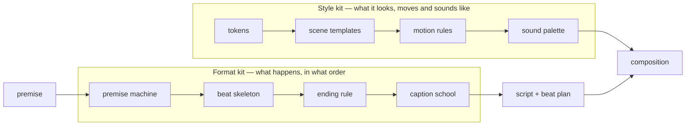
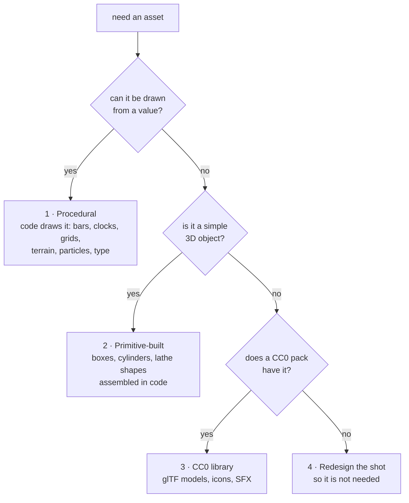
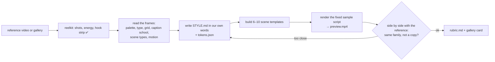

# 03 — Styles, formats and assets: one system, many looks

**Written 2026-11-13.** Design proposal. The goal the user stated: *multiple styles, one system
that works with all of them; choose a style template, enter a prompt, done.*

---

## 1. Two kits, not one

The structural finding from flashloop's library ([flashloop/FINDINGS.md](flashloop/FINDINGS.md) §5):
their templates are `<family>-<topic>` or a bare look. A family is a **story engine**; a look is a
**visual language**. They are independent, and the product is their cross-product.



| | Format kit | Style kit |
|---|---|---|
| Answers | What is the story engine? How long? How does it end? | What is on screen? How does it move? |
| Changes per | Series | Series (never per episode) |
| Count we need to start | **3** | **3** |
| Combinations that gives | 9 — not every pair is good; each format lists its compatible styles |

Three of each is the right first target. Flashloop launched its series formats with three
families. A catalogue of 99 looks we cannot rate — which is where `docs/STYLE_CATALOGUE.md`
currently sits — is worth less than three we have rendered.

## 2. Anatomy of a format kit

```
formats/<id>/
  FORMAT.md         the premise machine, in one sentence, with three worked premises
  skeleton.json     ordered beats: {id, job, share_of_runtime, must_contain}
  endings.md        how an episode closes and how it hands to the next
  captions.md       which caption school and why
  fits.md           compatible styles; premises this format should refuse
  rubric.md         what the script critic checks for THIS format
```

### Three starting formats

Derived from flashloop's three families and from our own measurement of two successful reels in
`docs/STORY_REEL_FINDINGS.md`. These are **our descriptions of common story shapes** — nobody owns
"a quantity doubles every day".

| Format | Premise machine | Skeleton | Ends on | Natural length |
|---|---|---|---|---|
| **The Rule** | One person gets one absurd involuntary rule | meet → rule fires harmlessly → rule fires at a bad moment → person tries to exploit it → it fires at the worst moment | A dilemma: keep the rule or lose it | 60–90 s |
| **The Doubling** | One quantity doubles each day | day 1 trivial → day 5 odd → day 10 a problem → day 20 world-scale → the number nobody expected | A number, then "what would you do on day N?" | 45–75 s |
| **The What-If** | One fact about the world changes | the change → first-order effect → second-order effect nobody guesses → who wins, who loses | A forced binary choice | 60–120 s |

Two cross-cutting rules, both measured rather than assumed:

- **End on a question with two defensible answers, not on a follow request.** Our 357k-like
  reference drew 4,545 comments this way.
- **Every episode is "Part N".** The badge is a promise.

## 3. Anatomy of a style kit

What the commercial kits ship, read from ReelStyles' own description — "a style guide, scene
templates, render steps and a rubric the agent checks its own frames against", plus characters and
motion rules — merged with what lemo-opuscar's `STYLE.md` files and our own swiss-motion reel
taught us.

```
styles/<id>/
  STYLE.md            the look in prose: essence, palette logic, type, composition, the NEVER list
  tokens.json         colours, type scale, grid, easing curves, durations, fps, safe areas
  scenes/             6–10 scene templates — parametric HTML/JS, each a pure render(t, props)
    title.js  compare.js  counter.js  dialogue.js  reveal.js  choice.js …
  captions.js         this style's caption component (school, position, highlight rule)
  characters/         the cast kit, if the style has people
  sets/               parametric locations, if the style has places
  motion.md           how things enter, hold, exit; what is banned
  sound.md            bed character, SFX vocabulary, how hits land
  rubric.md           what the frame critic checks for THIS style
  preview/            preview.mp4 (8 s) + 3 stills — the gallery card
  LICENSE.md          ours; plus a "derived from" line if a reference inspired it
```

### The contract every style kit must satisfy

This is what makes "one system, all styles" true. A style is valid only if:

1. **Every scene is a pure function of time.** `render(t, props)` gives the same frame for the
   same `t`. No timers, no randomness without a seed. (HyperFrames requires this anyway.)
2. **It reads timing from `timeline.json` and contains none of its own.**
3. **It declares its scene vocabulary** — the planner can only ask for scenes the kit has.
4. **Every element has an explicit exit.** Our reel-01 hit this: text drawn by offset alone was
   still on screen 15 seconds later.
5. **It ships its own caption component** and declares which school it uses.
6. **It declares its fps and why.** swiss-motion is 24 because its durations are note values;
   the 3D films want 60. One global fps is wrong.
7. **It declares how motion is verified.** Whole-frame freeze detection for 3D; an event-gap check
   over the timeline for flat 2D. This closes the open ROADMAP blocker on filmcheck M1.
8. **It renders its own 8-second preview** from a fixed sample script. No preview, no gallery
   card, not selectable.

### Three starting styles — chosen for what this machine can render

| Style | Register | Why first | Cost on no-GPU hardware |
|---|---|---|---|
| **Grid** (our swiss-motion work, re-authored as ours) | Flat 2D, type and bars | Already built once in `films/reel-01-agent-loop`; ~60 s render for 20 s | Lowest |
| **Console** | Diegetic UI — HUD panels, clocks, counters, feeds | STORY_REEL_FINDINGS concluded UI-from-data is what we are best at; a ticking counter is the cheapest tension device there is | Low |
| **Blocks** | Low-poly 3D, box characters with decal faces | It is the look of the user's own reference reel and flashloop's lead style; decal faces fix our expression problem | High — software WebGL was measured at ~650 ms a frame in onetake's notes |

⚠️ **Licence note on "Grid".** swiss-motion's spec is lemo-opuscar's and is **CC BY-NC 4.0**. The
user confirmed on 2026-11-13 that these videos are non-commercial, so using it is allowed with
attribution (ADR 0011). But a kit *we* ship as part of *our* system should be authored by us from
the public tradition (International Typographic Style is a hundred-year-old design movement, not
anyone's IP), per ADR 0008 — otherwise the whole system inherits a non-commercial restriction from
one style. That re-authoring is real work and is listed as such in the build plan.

## 4. Caption schools

Captions are the primary graphic element in short-form story content, not an accessibility layer
(STORY_REEL_FINDINGS §4). Three schools were observed across our two reference reels and five
flashloop previews:

| School | Looks like | Seen in | Best for |
|---|---|---|---|
| **Punch** | One word, centred lower third, caps, heavy outline, swapped on the syllable | Roblox reference; flashloop `block-story` | Fast narration over busy 3D |
| **Phrase + highlight** | One short line, a single key word in the signal colour | Cartoon reference; flashloop `pastel-clay` ("Meet **Nina**.") | Story beats with a name or number |
| **Karaoke fill** | A full sentence, words filling grey→black as spoken | flashloop `swiss-grid` | Editorial / explainer looks where the page is calm |

All three need the same input: `words.json`. The school is a rendering choice, made by the style.

## 5. Assets — where the things on screen come from

There is no illustrator and no GPU. So every asset has to be one of four kinds:



**Kind 4 is not a joke.** The cartoon reference carried its acting by *scale* — an extreme
close-up — not by animation. Writing around a missing asset is a craft skill and the planner
should be told it is allowed.

### Kind 1 — procedural

Already our strength. Everything in `films/reel-01-agent-loop` is this kind.

### Kind 2 — the character and set kits

- **Box characters with decal faces.** A head is a rounded box; the face is a small texture drawn
  on a 2D canvas at runtime from parameters: brow angle, eye shape, mouth shape. An "expression"
  is a row in a table, and switching expression is swapping a texture, timed to a word. This is
  how the block look gets acting without a rig, and it is cheap to render.
- **Cast as data.** `{skin, hair_shape, hair_colour, top, bottom, accessory}` in `bible.json`.
  Episode 4 reads the same record as episode 1.
- **Parametric sets.** A room is `{w, d, h, wall, floor, props[]}`. A small set of location
  builders — home, classroom, shop aisle, street, office — covers most "one person has a strange
  day" stories. Our own notes already say emptiness only reads against a container the eye can
  size, and that practical lights must be hung, not placed on the table (ERR-0005).

### Kind 3 — CC0 libraries (candidates, **none approved, none downloaded**)

| Source | What | Licence as reported | Check before use |
|---|---|---|---|
| Kenney | Low-poly 3D kits, UI, icons, **audio packs** | CC0 per kenney.nl/support | Kenney's own logo is not CC0 |
| Quaternius | Low-poly 3D characters and props | CC0 per secondary sources | Verify on each pack's page |
| Poly Pizza | Aggregator of low-poly models | **Varies per model — unverified** | Per-item, every time |
| Pixabay | Music, SFX | Pixabay licence, plus a CC0 filter | Per-file |
| Freesound | SFX | Mixed CC0 / CC-BY / CC-BY-NC | Per-file; filter to CC0 |
| Google Fonts | Type | OFL / Apache | Per-family |

Under CLAUDE.md rule 1, **each pack is its own approval** with licence, size and source stated.
Every asset that enters the repo gets a row in an `ASSETS.md` ledger: file, source URL, licence,
date. A film with an unlisted asset is not shippable — the same rule as tech-debt D3 for styles.

### What does *not* work here

- **Generated images or textures** — needs a paid provider or a GPU.
- **Rigged, skinned character animation** — possible in Three.js, but authoring it by code is slow
  and the result is usually worse than decal-face boxes.
- **Hand-painted 2D** (ClaudeAnimationBase's watercolour) — "seconds per frame" without a GPU.

## 6. How a new style gets made

This is the "reverse engineer anything" capability the user asked for, turned into a routine:



Two boundaries, stated once:

- **A look is not protected; a specific work is.** We can make "a flat cream page with red
  accents and grotesque type". We do not reproduce someone's characters, layouts frame for frame,
  logos or text. ReelStyles' own terms draw the same line for its buyers.
- **A competitor's style *document* is their copyright** even when the look is not. Read it to
  understand; write ours from the frames.

HyperFrames already ships two skills aimed at exactly this — `reverse-any-video` and
`style-sampling` — sitting unread in `external_tools/motion/hyperframes/skills/`. Reading those
two is the first step of building this routine, and costs nothing.
