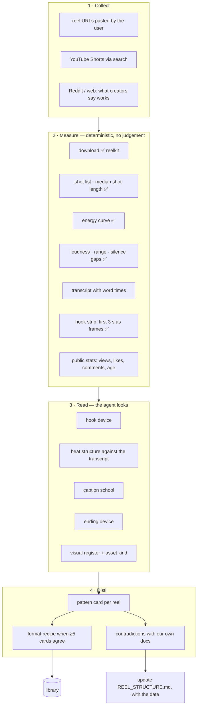
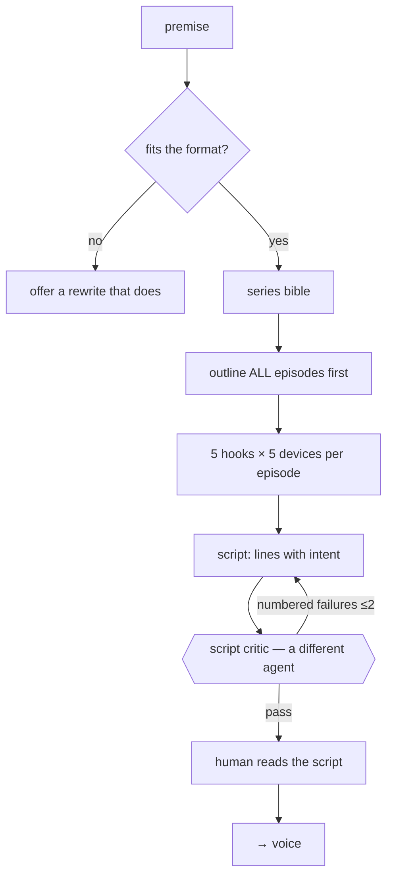

# 04 — The research engine and the story engine

**Written 2026-11-13.** Design proposal. The user's ask: *automatic research systems that can
analyse content, see the hooks, analyse, apply, story generation — a whole flow.*

This is the part **no product in [01-landscape.md](01-landscape.md) sells**. ReelStyles ships
static "format recipes" from a one-off study of 476 channels. Nobody analyses the user's own niche
on demand. It is the most original thing this system can do.

---

## Part A — The research engine

### A1. What it produces

Not a report. A **library of small, comparable records** the story engine can query.



✅ = already works in `tools/reelkit`. The measured half is mostly built. **The missing pieces are
the transcript, the stats, and the card.**

### A2. The pattern card

One file per analysed reel, small enough to compare fifty of them.

```json
{
  "id": "ig-DfTKsaUK-RZ",
  "source": "instagram", "account": "@…", "analysed": "2026-11-13",
  "measured": {
    "duration_s": 125.3, "shots": 65, "median_shot_s": 1.73,
    "lufs": -14.2, "lra": 4.3, "silence_gaps_over_0.35s": 0,
    "words_per_minute": null,
    "likes": 357000, "comments": 4545
  },
  "hook": {
    "first_words": "…",
    "first_frame": "…",
    "device": "open_loop | value_promise | pattern_interrupt | question | stakes | contrarian",
    "seconds_until_subject_is_named": null,
    "readable_muted": true
  },
  "structure": [
    {"t": [0, 4], "job": "hook"},
    {"t": [4, 20], "job": "setup"},
    {"t": [20, 95], "job": "escalation", "steps": 4},
    {"t": [95, 125], "job": "dilemma"}
  ],
  "captions": "punch | phrase_highlight | karaoke",
  "ending": "binary_choice | cliffhanger | reveal | ask | loop",
  "series": {"part_badge": true, "part": 1},
  "register": "blocks_3d | flat_2d | ui | mixed",
  "what_we_can_reproduce": "…",
  "confidence": "measured fields are measured; read fields are one agent's reading"
}
```

The last field is not decoration. Half the card is instrument output and half is opinion, and the
two must never be averaged together as if they were the same kind of fact.

### A3. Choosing what to analyse — outliers, honestly

The useful question is not "what do popular videos look like" but "**what did this account do
differently the time it worked?**" That is an outlier relative to an account's own baseline:

```
outlier_score = views_of_this_video / median_views_of_the_account's_last_N_videos
```

Analyse the videos scoring above ~5× and, for contrast, a few at ~1×. The *difference* between
those two sets is the finding.

**What blocks this today, plainly:**

| Need | Status |
|---|---|
| Per-reel download and measurement | ✅ works, Instagram and others, no login |
| Enumerating an Instagram account's posts | ⛔ yt-dlp marks `instagram:user` broken; the alternative needs the user's login cookie, unapproved |
| YouTube Shorts: channel listing with view counts | Likely works via yt-dlp's flat playlist mode — **untested** |
| Retention curves (the real signal) | ⛔ **Private to each creator. Unavailable for anyone else's video, by any tool.** Public views, likes and comments are a weak proxy and must be called one |
| Transcription of references | Not installed — needs a speech-to-text engine (approval) |

So the realistic first version is **YouTube-Shorts-first for outlier detection**, with Instagram
reels analysed one at a time when the user pastes them. That is a limitation, not a design choice.

### A4. The hook taxonomy

A starting vocabulary, so cards are comparable. It merges `docs/REEL_STRUCTURE.md`'s five devices
with what the two measured reels added.

| Device | Mechanism | Example shape |
|---|---|---|
| **Open loop** | Show the end state first, unexplained | "By day 30, nobody could leave the city." |
| **Stakes clock** | A visible resource is already running out | Battery 31%, counting down |
| **The rule** | State an absurd constraint as fact | "Every time I sneeze, I teleport." |
| **Value promise** | Name the payoff | "Three settings. One is slowing you down." |
| **Contrarian** | Deny something the viewer believes | "Your agent is not a chatbot." |
| **Pattern interrupt** | Something in frame is wrong | The grid, with one element off it |
| **Direct question** | Put the viewer in it | "Would you take the red one?" |

Rules that hold across all of them (from Meta's own Reels guidance and creator folklore read on
2026-11-13 — **agreed-on, not measured by us**): frame 1 is already content; readable with the
sound off; the subject is named within about three seconds.

### A5. How findings get applied — the part most systems skip

"Analyse" is easy and "apply" is where research usually dies. Three concrete hand-offs:

1. **Hook candidates.** The writer must produce **five hooks using five different devices** for
   every episode, then the critic picks. The library supplies real examples of each device in the
   same niche as few-shot references — *examples of the device, never text to reuse*.
2. **Budgets.** Format recipes carry measured numbers — median shot length, words per minute,
   seconds to the first escalation — which the timeline compiler enforces as limits.
3. **Standing corrections.** When cards contradict our own docs, the docs change, dated. This
   already happened once: two reels showed our 30–40 s target and "no cuts" rule were wrong for
   story content.

### A6. The feedback loop that is still missing

The loop only closes when *our own* published episodes come back as data. That needs the user's
own analytics, exported by the user. It is the one place real retention curves are available to
us — for our own videos. Until then every recipe is borrowed evidence.

---

## Part B — The story engine

### B1. Shape



### B2. The series bible

Written once per series, read by every later stage.

| Section | Contents |
|---|---|
| **Logline** | One sentence. If it needs two, it is two series |
| **The engine** | The rule / the doubling quantity / the changed fact — and its exact limits |
| **Cast** | 1–3 characters as data: look, one want, one flaw, voice id |
| **World** | 2–4 locations as set parameters |
| **Stake meter** | The on-screen number that moves (day count, battery, money, distance) |
| **Tone** | Three adjectives and three banned ones |
| **Ledger** | What each finished episode used, so nothing repeats |

### B3. Episode outline rules

- Outline every episode before scripting one, so episode N's ending is a promise episode N+1 keeps.
- **Escalate in kind, not just in size.** "Bigger" three times is one beat repeated. Personal →
  social → systemic is three beats.
- One **second-order consequence** per episode that the viewer would not have guessed. This is
  what makes a what-if worth watching instead of merely plausible.
- End on the dilemma. Two answers, both defensible, each costing something.

### B4. The script schema

```json
{
  "id": "L07",
  "text": "By day twelve, the pile was taller than her house.",
  "intent": "escalation",
  "on_screen": "counter flips 11→12; house in frame for scale; pile exceeds roofline",
  "emphasis_word": "taller",
  "scene": "compare",
  "meter": {"day": 12}
}
```

`on_screen` is written by the writer, in words, *before* any code. A line whose `on_screen` is
"text of the line" has no picture and gets rewritten — that is the "text-heavy slides" failure
named in CONTEXT.md, caught at the cheapest possible moment.

### B5. Budgets the script must meet

Starting values. The measured ones come from our two reference reels; the rest are **assumptions
to be replaced by library data**.

| Budget | Value | Basis |
|---|---|---|
| Episode length | 60–90 s | Measured references ran 79 s and 125 s |
| Speaking rate | ~150–170 wpm → 150–250 words per episode | **Assumption** — no transcript measured yet |
| Silence gaps over 0.35 s | Near zero | Measured: 0 in 125 s |
| Line length | ≤ 14 words | Assumption; keeps one line to one scene |
| Scene change | Every 1.5–2.5 s | Measured medians 1.6 s and 1.73 s |
| Subject named by | 3 s | Platform guidance |
| Words on screen (non-caption) | ≤ 9 at once | Existing GOAL.md T1 |

### B6. The script critic's rubric

A separate agent, given only the bible, the format rubric and the script. It returns numbered
failures, never edits.

1. Does the first line work with the sound off, as text?
2. Is the subject named within the first two lines?
3. Does every line have a picture that is not its own text?
4. Does each escalation step change *kind*?
5. Is there one consequence a viewer would not have predicted?
6. Is any line cuttable without loss? (If yes, cut it.)
7. Does the ending offer two defensible answers?
8. Read aloud at the target rate, does it fit the length?
9. Is anything factually asserted that is not true? A what-if may invent the premise; it may not
   invent the physics it then claims is real.
10. Does it reuse anything in the bible's ledger?

Rule 9 matters more than it looks. "What if the moon were twice as close" videos live or die on
whether the consequences are *right*. A separate fact pass on the numbers — tide height, orbital
period — is cheap and is the difference between an explainer and slop.

---

## What this part costs to build

| Piece | Depends on | Size |
|---|---|---|
| Pattern-card schema + `reelkit card` command | Nothing new | Small |
| Transcription of references | A speech-to-text engine — **needs approval** | Small once approved |
| YouTube Shorts outlier finder | Testing yt-dlp flat listing | Small–medium |
| Format kits ×3 | Reading ~10 references per format | Medium — mostly reading |
| Bible + script schemas + critic rubric | Nothing new | Small |
| Fact-check pass | Web search | Small |

None of Part B needs anything installed. **The story engine can be built and tested today**, on
paper, before a single frame — and it is the half of the system the user will judge first.
