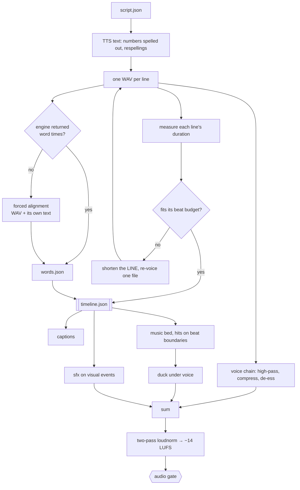

# 05 — Audio: voice, captions, music, sound effects, mix

**Written 2026-11-13.** Design proposal plus an options review.

**The constraint that leads:** no film in this project has ever had sound. Narration has been
blocked since 2026-11-12 on a manual VoiceStudio setup step. In the timeline-first design
([02-system-architecture.md](02-system-architecture.md) §2) the voice is the *clock*, so until an
engine works, **nothing downstream of the script can be built properly**. This is the critical
path of the whole system.

---

## 1. The audio pipeline

## 2. Voice engines — the options

Lead with what changes the decision: **two of these are already on the machine, and the one that
works is on an archived upstream.**

| Engine | Licence | Cost | Hardware | Word timings | Status here | Most likely to go wrong |
|---|---|---|---|---|---|---|
| **VoiceStudio** | 🟡 AGPL-3.0 | $0 | CPU ok, slower | **Unknown — never verified** (open since ADR 0004) | Installed, ⛔ setup not finished | The first-run step needs the user, and a multi-GB model choice |
| **Piper** | 🟢 MIT | $0 | CPU, fast | No | ✅ Installed and working | **Upstream archived** (last push 2025-08-26). Flat delivery — fine for drafts, weak for stories |
| **Kokoro-82M** | 🟢 Apache-2.0 | $0 | CPU-capable | **Yes, natively** via wrappers — English only | Not installed | Fixed preset voices, no cloning; model repo unchanged since 2025-08 |
| **Kokoro-FastAPI** (wrapper) | 🟢 Apache-2.0 | $0 | CPU Docker image published | **Yes — a captioned-speech endpoint** | Not installed | Needs Docker or a Python env; a model download |
| **Chatterbox** | 🟢 MIT | $0 | Realistically wants a GPU | No | Not installed | Too slow on integrated graphics — untested, but likely |
| Edge TTS | Proprietary free endpoint | $0 | None (cloud) | Yes | Not installed | Unofficial use of a Microsoft service; can be cut off; not local |
| ElevenLabs | Proprietary | **Paid, per character** | None (cloud) | Yes | — | Breaks ADR 0002 zero-key; best quality by a distance |

### Recommendation, with its downside

**Unblock in this order:**

1. **Finish the VoiceStudio setup** — it is already installed and already the decision (ADR 0004).
   One GUI pass by the user. *Then verify the open question: does it emit word timings?*
2. **If it does not, or if it is too slow on this CPU: propose Kokoro** as the timing-capable
   engine. That is a new install and a model download and needs its own approval under rule 1 —
   size, source and licence stated at that point, not assumed here.
3. **Forced alignment as the engine-independent fallback** — also a new install.

The downside of this order: step 1 has been "one GUI pass away" for two days. If it stays blocked,
the honest move is to propose Kokoro and stop waiting — Piper cannot carry a story reel and gives
no timings.

Kokoro is what the working open-source examples use: `vincentsch/explainroo` (Kokoro + Whisper
timing), `gyoridavid/short-video-maker` (Kokoro + Whisper captions), lemo-opuscar and onetake
(Kokoro, per our own registry notes). It is the de facto local choice. That is evidence it works,
not evidence it sounds good enough — **nobody here has heard it yet.**

## 2a. VoiceStudio, measured 2026-11-13

The user finished setup. Verified from the CLI with the bundled demo voice:

| | |
|---|---|
| `voicestudio speak` | ✅ Works. Two sentences rendered to WAV |
| Output | 24 kHz mono 16-bit PCM |
| **Speed on this machine** | **54 s for 3.0 s of audio, then 47 s for 3.4 s** — roughly **14–18× slower than real time**, CPU only. Two samples, so indicative |
| Raw loudness | −19.3 LUFS, true peak −1.9 dBTP — needs the mix stage to reach −14 |
| **Word timings** | ❌ **Not returned by `speak`.** `--json` gives only the file path and size |
| Transcription from the CLI | ❌ No file-transcription command found (`dictation` is live dictation only). A Whisper large-v3 Turbo model *is* installed inside VoiceStudio; whether the local API on port 3900 exposes it for files is **unverified** |
| Engine and licence | `k2-fsa/OmniVoice`. VoiceStudio's own registry marks the **weights CC-BY-NC — non-commercial**, with commercial use of outputs "unknown" |
| Saved voices | The demo voice, and a clone of the user's own voice |

**What this changes:**

1. **Narration is unblocked.** The critical path is open.
2. **Budget the time.** At ~15× real time, a 75-second episode is roughly **15–20 minutes of
   voice generation**. One WAV per line makes that resumable and lets one line be re-voiced alone.
3. **Word timings are still an open problem.** Options: find a file-transcription route in
   VoiceStudio's local API (no install); or a forced aligner (a new install, needs approval).
4. **The voice model is non-commercial.** Consistent with the user's 2026-11-13 statement that
   these videos are non-commercial — but it is now a *second* non-commercial dependency alongside
   lemo-opuscar's styles, and would have to be replaced (Kokoro is Apache-2.0) if that changes.
5. **Not judged:** I measured the audio; I cannot hear it. Whether it sounds good is unverified.

## 3. Captions

Input: `words.json`. Output: one of the three schools in
[03-style-and-format-system.md](03-style-and-format-system.md) §4, rendered **inside the
composition**, not burned on afterwards — so captions obey the style's type, colour and motion.

Rules, each of which is a checkable assertion over `timeline.json` rather than over pixels:

| Rule | Check |
|---|---|
| A word appears no later than it is spoken | `caption.start ≤ word.start + 1 frame` |
| No caption outlives its phrase by more than ~0.3 s | exit time vs last word end |
| Safe area: never under the platform UI | fixed y-band, bottom ~20% and top ~12% excluded |
| Max characters per line | per style token |
| Digits in captions, words in TTS text | already our convention |
| The emphasis word is the one the script named | `emphasis_word` matches the highlighted token |
| Contrast against the busiest frame it sits on | measured on snapshots |

HyperFrames ships a `captions-overlay` skill we have not read. Reading it comes before designing
our own component.

## 4. Music

| Route | Licence | Cost | Verdict |
|---|---|---|---|
| **Score it in code** — a small sampler or WebAudio synth driven by the timeline | Ours | $0 | The lemo-opuscar approach: write the bed *from the cue map*, so hits land on visual events by construction. Most work, best sync, no licence question |
| **CC0 loops**, cut to length | CC0, per file | $0 | Fastest. Sync is approximate; needs a ledger entry per track |
| **Pixabay-licence tracks** | Pixabay licence | $0 | Fine; read the licence on Content ID claims before relying on it |
| Generative music models | Varies | GPU or paid | Out of scope |
| Commercial libraries | Paid | Subscription | Breaks zero-key |

**Start with CC0 loops; move to scored-in-code once a format has settled.** A story reel's bed is
a constant-energy texture under the voice, not a composition — our measurement showed loudness
range of 2–4 LU and no dynamics to speak of.

⚠️ This **contradicts the swiss-motion sound spec** we adopted, which wants dropped drums, near
silence and hard stops. Both are right for their own product: dynamics for a 20-second design
reel, a flat wall for a narrated story. Sound is therefore a *format* property as much as a style
property, and the format wins when they disagree.

## 5. Sound effects

A **cue map**: every visual event in the timeline that deserves a sound has an entry.

| Event class | Sound | Rule |
|---|---|---|
| Cut / scene change | Short whoosh or tick | Not on every cut — at 1.7 s a shot that is 70 whooshes |
| Counter or meter tick | Click | Pitch may rise with the stake |
| Caption emphasis word | Soft hit | At most one per line |
| Reveal | Riser → impact | Back-timed so the impact lands on the frame |
| Character action | Foley from a small CC0 set | Only what is seen |

Source: a CC0 pack (Kenney's audio packs are reported CC0), each file in the asset ledger. Budget:
a library of roughly 30 sounds covers the table above.

## 6. Mix targets

| Measure | Target | Basis |
|---|---|---|
| Integrated loudness | **−14 LUFS** | GOAL.md A1; both reference reels measured −14.1 / −14.2 |
| Loudness range | **2–5 LU** for story formats | Measured 2.1 and 4.3 |
| True peak | ≤ −1 dBTP | Standard headroom for lossy re-encode |
| Voice over bed | Voice ~10 dB above music | Existing playbook figure |
| Silence gaps > 0.35 s | ~0 in story formats | Measured: 0 in 125 s |
| Sample rate / codec | 48 kHz AAC | Platform norm |

All of it is FFmpeg, which is installed: `loudnorm` two-pass, `sidechaincompress` for ducking,
`silencedetect` for gaps. `tools/filmcheck` already measures LUFS; LRA, true peak and gap count
are small additions.

## 7. The audio gate

| Check | Blocker? |
|---|---|
| Audio track present and not silent | Yes — the −70 LUFS empty track on the first demo is the precedent |
| Integrated loudness within ±1 LU of target | Yes |
| True peak under ceiling | Yes |
| LRA inside the format's band | Warning |
| No narration gap over the format's limit | Warning |
| Every caption word within one frame of its spoken time | Yes |
| Every cue-map SFX within one frame of its visual event | Yes — lemo-opuscar's "cue check, target 0 ms" |

**What this gate cannot measure, to be written in every report:** whether the voice sounds human,
whether the read has the right emotion, whether the music suits the story, whether the mix is
pleasant. Those need ears. A person listens before anything is called done.
