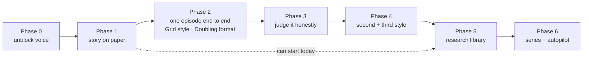

# 06 — Gap analysis and build plan

**Written 2026-11-13.** A proposal. No part of this plan has been started, and nothing in it has
been approved.

---

## 1. Where "a better one" is actually possible

Being better than flashloop at being flashloop is not available: they have paid models, a hosted
library and mobile apps. Being better **at the code-rendered faceless series** is, because the
whole market is weak in the same three places ([01-landscape.md](01-landscape.md) §A):

| Gap in the market | Evidence | Our position |
|---|---|---|
| **Sound** | Three of four commercial kits are silent or bring-your-own-audio | Unbuilt here too — but designed timeline-first, which they are not |
| **Research** | Nobody analyses your niche; best on offer is a static recipe list | Half-built: `reelkit` measures any reel today |
| **Judgement** | One kit ships a self-check rubric, where the builder grades itself | Our strongest asset: `filmcheck`, separate critic, "look at the frames", measured gates |

So the claim worth aiming at is narrow and real: **episodes that are narrated, word-captioned and
mixed by default, built from researched formats, and checked by something other than their
author.**

## 2. Component inventory

| # | Component | Have | Gap | Size |
|---|---|---|---|---|
| 1 | Render runtime | HyperFrames ✅ | — | — |
| 2 | Quality gate (picture) | `filmcheck` ✅ | Event-gap check for 2D; caption checks | S |
| 3 | Continuous camera | `onecam` ✅ | Belongs to the 3D film product, not story reels | — |
| 4 | Reference intake | `reelkit` ✅ | Transcript, stats, pattern card | S–M |
| 5 | Pattern library | — | Schema, storage, queries | S |
| 6 | Outlier finder | — | YouTube Shorts listing; Instagram account listing is blocked | M |
| 7 | Format kits | Prose in `REEL_STRUCTURE.md` | Three kits in the common shape | M |
| 8 | Series bible | — | Schema + discipline | S |
| 9 | Script schema + critic | — | Schema, rubric, fact pass | S |
| 10 | **Narration** | Piper (archived), VoiceStudio ⛔ | **A working engine** | ⛔ blocked on a decision |
| 11 | **Word timings** | — | Engine-native or forced alignment | S after #10 |
| 12 | **Timeline compiler** | — | script + words → `timeline.json` | M |
| 13 | Style kits | One reel, two films, 99 unrated specs | Three kits meeting the 8-point contract | **L** |
| 14 | Caption components | — | Three schools | M |
| 15 | Character + set kits | Two faceless figures with stump arms | Box cast with decal faces; 5 set builders | **L** |
| 16 | Asset ledger + CC0 packs | — | Ledger; each pack is an approval | S + approvals |
| 17 | Editing grammar (cuts) | Opposite — a rig that forbids cuts | Shot-change rules for story reels | M |
| 18 | Music | — | CC0 beds first | S |
| 19 | SFX + cue map | — | ~30 sounds, cue schema | S–M |
| 20 | Mix + audio gate | LUFS in `filmcheck` | Ducking chain; LRA, peak, gap, sync checks | S–M |
| 21 | Film critic | On paper | An agent that reads snapshots + measures and writes `report.md` | M |
| 22 | Orchestration skill | `AGENT_GUIDE.md` | One written entry point for the whole flow | M |
| 23 | Style gallery | — | A folder of previews and an index page | S |
| 24 | Packaging | — | Title, description, cover frame | S |
| 25 | Scheduler / autopilot | — | Last, deliberately | later |

S ≈ a session, M ≈ a few sessions, L ≈ many. These are judgement, not measurement.

## 3. The plan — vertical slice first

The mistake this project has made twice is building a component well before proving the chain.
`onecam` is excellent and the film it serves still has no sound and no face. So: **one episode,
all the way through, in the cheapest style, before any second style or format.**

### Phase 0 — Unblock the clock ⛔ *needs the user*

| Task | Done when |
|---|---|
| Finish VoiceStudio first-run setup, or approve an alternative engine | `speak` produces a WAV from the CLI |
| Verify word timings | A `words.json` for one sentence, checked by ear against the audio |

Nothing in Phases 2–4 can be done properly without this.

### Phase 1 — The story engine, on paper *(no installs, can start now)*

| Task | Done when |
|---|---|
| Write the **Doubling** format kit | `FORMAT.md`, skeleton, rubric exist; three sample premises classified correctly |
| Bible + script schemas | One series bible and one episode script validate |
| Script critic | A fresh agent returns numbered failures on a deliberately flawed script — and finds the planted flaws |
| Human reads episode 1's script | The user says the story is worth making |

The last row is the real gate. If the script is not good as text, no renderer will save it.

### Phase 2 — One episode, end to end

Style: **Grid** (flat 2D, the cheapest to render, already prototyped). Format: **Doubling** (its
picture is a counter and a comparison — pure code, no characters, no assets).

| Task | Done when |
|---|---|
| Timeline compiler | `timeline.json` produced from script + words; composition holds no timings |
| Grid kit, re-authored as ours, 6 scene templates | Each renders alone at a fixed `t` |
| Karaoke caption component | Words land within one frame of `words.json`, asserted by a check |
| CC0 bed + ~10 SFX + mix | −14 LUFS ±1, peak ≤ −1 dBTP, measured |
| Render | 1080×1920 MP4, 60–75 s, ffprobe-verified |

### Phase 3 — Judge it

| Task | Done when |
|---|---|
| `filmcheck` + event-gap check + audio gate | Exit 0, or failures listed |
| Fresh film critic reads snapshots and measures | `report.md` with a "not measured" section |
| **The user watches it with sound** | A verdict in their words, recorded in MEMORY.md |

Then, and only then, decide whether the architecture is right.

### Phase 4 — Prove "one system, many styles"

| Task | Done when |
|---|---|
| **Console** style kit | Same script as Phase 2 renders in it with **zero changes to script or timeline** |
| **Blocks** style kit: box cast, decal faces, 3 set builders | A **Rule**-format episode renders; faces read at phone size |
| Punch + phrase-highlight captions | Each style uses its own school |
| 8-second previews + gallery | Three cards, each rendered from the same sample script |

The first row is the actual test of the user's goal. If swapping the style requires touching the
script, the abstraction is wrong and it should be fixed there, at three styles, not at thirty.

### Phase 5 — The research library *(parallel with 2–4)*

| Task | Done when |
|---|---|
| `reelkit card` + transcription | A pattern card for each of the two reels already on disk |
| 10 cards per format | A format recipe whose numbers are measured, replacing §B5's assumptions |
| Shorts outlier finder | Lists an account's videos by outlier score — or a written finding that it cannot |

### Phase 6 — Series, then autopilot

Four episodes from one premise with a persistent bible; only after that, a scheduled run. The
last thing built, because an unattended loop multiplies whatever quality level it starts from.

## 4. Decisions needed from the user

In the order they block work:

1. ~~Voice.~~ **VoiceStudio is set up and verified 2026-11-13** — see [05-audio.md](05-audio.md) §2a.
   What remains is word timings and its speed on this CPU.
2. **Flashloop account.** Whether to create a free account and connect its MCP once, to settle
   where their render runs and what a style looks like on the wire
   ([flashloop/FINDINGS.md](flashloop/FINDINGS.md) §9). Useful, not blocking.
3. ~~Where this lives.~~ **Decided 2026-11-13:** the research lives in
   `market_research_and_intelligence/` in this repo.
4. ~~`research/` is gitignored.~~ **Resolved 2026-11-13** by the move; the files are now
   committable. They are still **uncommitted** until the user asks.
5. **First format and first style.** The plan proposes Doubling × Grid for cost reasons. The
   user's own references are Rule × Blocks — more appealing and several times more work.
6. **Commercial or not.** Confirmed non-commercial on 2026-11-13. If that ever changes, the Grid
   kit must already be ours and not lemo-opuscar's — the plan assumes that re-authoring.
7. **Approvals that will come up**, each to be asked on its own with licence, size and source:
   a speech-to-text engine for reference transcripts; a forced aligner; CC0 asset packs; CC0
   audio packs.

## 5. Risks, most likely first

| Risk | Why it is likely | Mitigation |
|---|---|---|
| **Voice stays blocked** | It has been, for two days | Decision 1; do Phase 1 and 5 meanwhile |
| **Local voice is not good enough for story content** | Nobody here has heard Kokoro or VoiceStudio narrate a story | Phase 3 has a human listening gate; ElevenLabs exists as a paid, non-default option |
| **The Blocks style is too slow to iterate on** | No GPU; software WebGL measured elsewhere at ~650 ms a frame → a 75 s episode at 30 fps is ~25 min per render | Low-poly budget; draft at half resolution; it is third, not first |
| **Agent cost per episode** | Published medians: 14 min of agent time for 30 s | Human gates before rendering; resumable artefacts |
| **Gates pass, film is poor** | Has happened on every film so far | The human gates are not optional; reports name what was not measured |
| **Style abstraction leaks** | Scripts tend to assume a look | The Phase 4 zero-change test |
| **Research signal is weak** | Retention is private; public stats are a proxy | Say so on every card; close the loop with our own analytics later |
| **Scope** | 25 components | The vertical slice. Nothing is built twice before it is proven once |

## 6. What not to build

- A web UI, a timeline editor, or a hosted service.
- More than three styles before the zero-change test passes.
- A scheduler before one episode has been judged good by a person.
- Anything that needs a GPU or a paid key, without a decision that says so.
